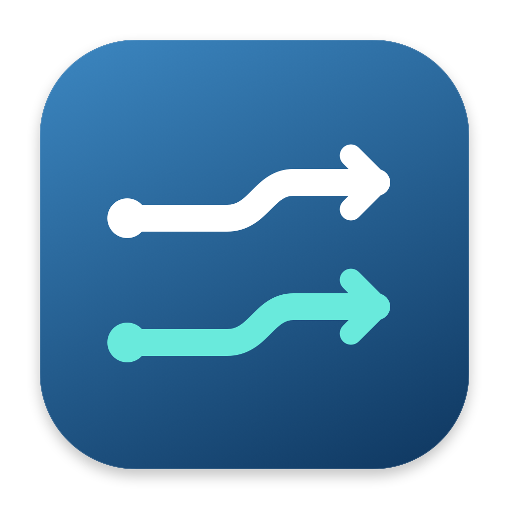

  

<h1 align="center">TunnelDeck</h1>

  Your WireGuard tunnels. Connected together. 
  A native macOS app for managing multiple split tunnels from one simple interface.

  <strong>Apple Silicon · macOS 14+</strong>

  <a href="https://github.com/timfeskens/tunneldeck/releases/latest"><strong>Download for macOS</strong></a>
  · <a href="https://github.com/timfeskens/tunneldeck/releases">Release notes</a>
  · <a href="https://github.com/timfeskens/tunneldeck/issues">Report a bug</a>

## Multiple tunnels, less switching

- **Stay connected to different networks** with independent tunnel controls.
- **Manage connections from the menu bar** or the native macOS window.
- **Keep the Dock clear** by closing the window or choosing Hide to Menu Bar.
- **Import your existing profiles** from WireGuard `.conf` files or ZIP exports.
- **Export selected tunnels** to a standard WireGuard ZIP archive.
- **Connect automatically** on Wi-Fi, Ethernet, or selected Wi-Fi networks.
- **See connection details** with route warnings, handshake times, and transfer stats.
- **Keep configurations in Keychain**, with keys hidden by default.

No TunnelDeck account, telemetry, or cloud service. The WireGuard runtime is
included—**no Homebrew required**.

## Get started

1. [Download the latest DMG](https://github.com/timfeskens/tunneldeck/releases/latest).
2. Drag **TunnelDeck.app → Applications**, eject the DMG, and open the app.
3. Approve **Install / Update…** once to set up the background service.
4. Import your profiles and connect. Connecting another tunnel leaves the first running.

> **Early release · not notarized.** Current builds are ad-hoc signed, not Developer
> ID signed. If macOS blocks launch, use **System Settings → Privacy & Security →
> Open Anyway** only for a download you trust. Do not disable Gatekeeper globally.

Only Apple Silicon Macs are supported; no Intel build is available.

## Before you connect

- **Split tunnels only.** Networks must not overlap. Full-tunnel mode and a kill
  switch are not supported.
- **Your system DNS stays unchanged.** Imported DNS settings are not applied.
- **Use each profile in one app at a time.** Deactivate its old copy and disable
  its on-demand rule before connecting it here.
- **Quitting leaves tunnels connected.** Reopen the app to manage them. Disconnecting
  a tunnel also disables its on-demand rule.
- **Early, unaudited software.** Route status and handshakes do not guarantee
  application reachability. Tunnels do not appear in **System Settings → VPN**.

TunnelDeck uses your existing WireGuard configurations; it is not a VPN provider
and is not affiliated with the WireGuard project.

## Learn more

- [User guide](docs/USAGE.md) — on-demand rules, route repair, updates, and limitations.
- [Security](SECURITY.md) — permissions, key handling, and private vulnerability reports.
- [Development](docs/DEVELOPMENT.md) — build from source and package releases.

## License

[MIT](LICENSE), including the app icon. Bundled Bash and WireGuard tools retain
their own licenses; notices and corresponding sources accompany every release.
See [third-party notices](THIRD_PARTY.md).
